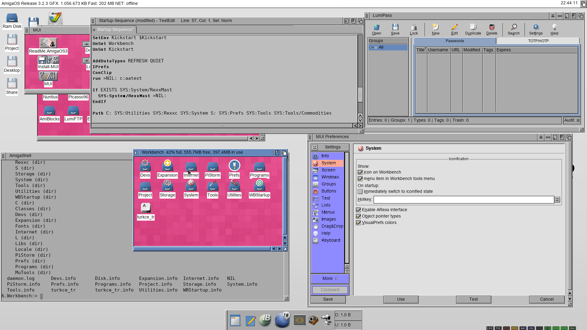
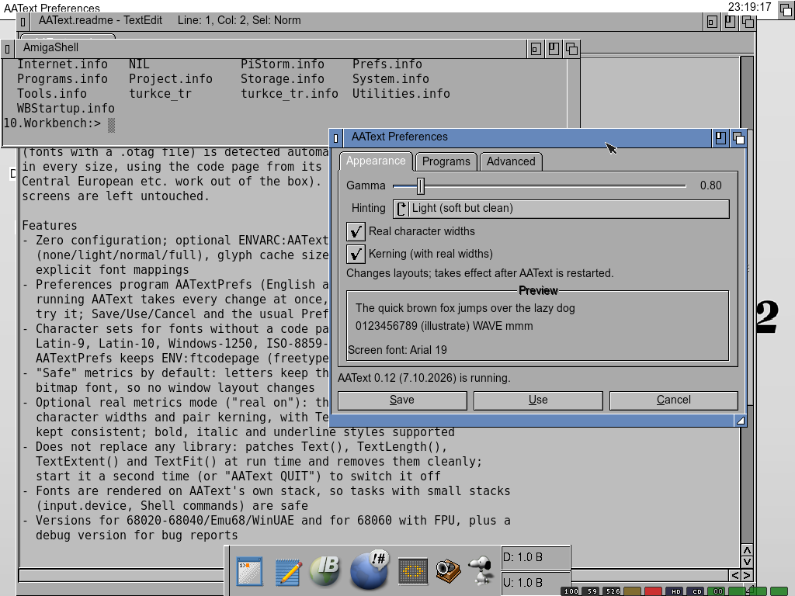
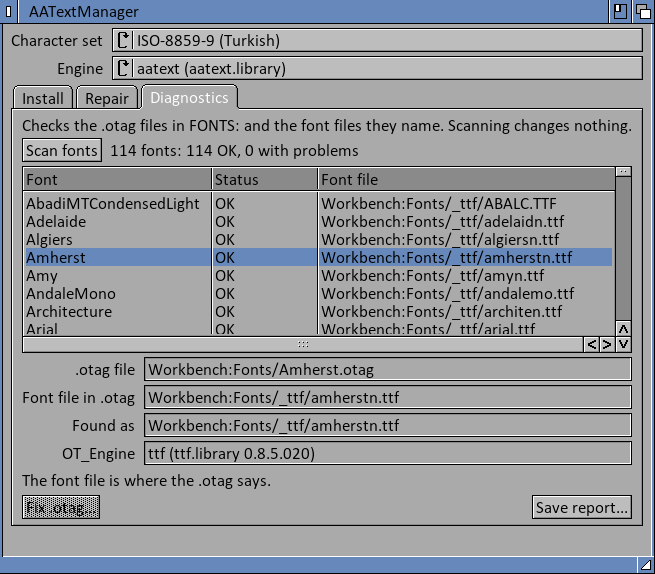
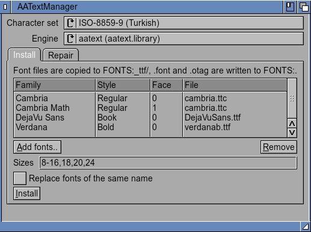

# AAText

Antialiased TrueType text for AmigaOS 3.2 on RTG screens.



*AmigaOS 3.2.3 on PiStorm (Emu68), Picasso96, 1920×1080: Workbench, Shell,
TextEdit, MUI Preferences and LumiPass, all with antialiased TrueType text.*

AAText makes Workbench and applications draw TrueType fonts smoothly: icon
labels, menus, window and screen titles, Shell windows, GadTools, ReAction
and MUI programs — everything that draws text through `graphics.library`.

- **Zero configuration.** Every TrueType or OpenType (CFF) font installed with a font manager
  (a `.otag` file next to the `.font` file) is detected automatically and
  drawn antialiased in every size, using the code page from its `.otag` file.
- **No replaced libraries.** AAText patches `Text()`, and optionally
  `TextLength()`, `TextExtent()` and `TextFit()`, at run time and removes the
  patches cleanly when it quits.
- **Safe metrics by default.** Letters keep the cells of the system's bitmap
  font, so no window layout changes. Optional real metrics mode (`real on`)
  uses the TrueType widths and pair kerning and keeps all measuring functions
  consistent.
- **Preferences program.** AATextPrefs (English and Turkish) changes gamma,
  hinting, the program blacklist and the other settings with a live preview:
  a running AAText takes every change at once.

  

- **Font diagnostics.** AATextManager checks the `.otag` files in `FONTS:` and the
  font files they name, finds fonts whose `.otag` points to a moved or missing
  file (e.g. after the boot volume was renamed) and can fix them, keeping a
  backup.

  

- **Font installer.** AATextManager installs TrueType and OpenType fonts like
  FTManager, but writes the code page of a character set into the `.otag` (so
  Turkish and other letters work without `ENV:ftcodepage`) and names the font
  file without a volume name. It also repairs installed fonts: moved file, no
  code page, engine `aatext` (fonts installed before 2.15) -> `freetype2`.
  Selecting a font shows a preview in several sizes before it is installed.
  Window and Shell, English and Turkish; uses `freetype2.library` 2.15
  (included: AAText's FreeType 2.15.0 library, called `aatext.library`
  before; it replaces freetype2.library 1.x, which the installer keeps as
  `LIBS:freetype2.library.bak`).

  

- Bitmap fonts and palette (AGA) screens are left untouched.

*Türkçe açıklama aşağıda.*

## Requirements

- AmigaOS 3.2 or newer, 68020 or better
- RTG with `cybergraphics.library` (e.g. Picasso96)
- TrueType or OpenType fonts installed with `.otag` files (ttf.library, or
  freetype2.library + FTManager)

Tested on AmigaOS 3.2.3 with WinUAE (UAEGFX) and PiStorm (Emu68).

## Changes in 0.46

Built on FreeType 2.15.0; the new harfbuzz.library (separate archive) on
HarfBuzz 15.1.0.

- **`aatext.library` is no longer used.** AAText's FreeType library is now
  `freetype2.library` 2.15 (FreeType 2.15.0), with the same function order and
  `.otag` tags as `freetype2.library` 1.x, so fonts installed with FTManager
  and programs written for 1.x keep working. Fonts installed with
  AATextManager before (engine `aatext`) are switched to `freetype2` by
  AATextManager's Repair tab; after that `LIBS:aatext.library` can be deleted.
- **The old library is kept automatically.** `Install-AAText` copies an
  older `LIBS:freetype2.library` (1.x) to `LIBS:freetype2.library.bak`
  before it installs the new one; to go back, copy it back.
- Kerning from the GPOS table also in `freetype2.library`'s font engine.
- ClearType (subpixel): hinting for LCD output, new `lcdfilter` setting
  (AATextPrefs), and the installer asks about ClearType on a first
  installation.
- Faster drawing: ClearType blending and bold text (on the A1200 with
  PiStorm: lines +13%, bold +65%), and RGBA buffers, which Picasso96 writes
  about three times faster on WinUAE.
- New `harfbuzz.library` (HarfBuzz 15.1.0 text shaping as a shared library,
  `hblib/`), in its own archive `harfbuzz_lib.lha`.

## Download and installation

Binary releases are on Aminet (`util/wb/AAText.lha`) and on the
[Releases](https://github.com/Sdursun/AAText/releases) page. Unpack the archive and
double-click `Install-AAText` (the OS 3.2 Installer): it installs everything,
adds AAText to `S:User-Startup` and can remove it again. By hand: copy `AAText` to
`C:` and add `Run >NIL: C:AAText` to `S:Startup-Sequence`, after the monitor
drivers are loaded and before `LoadWB` (not to `WBStartup`: AAText must run
before Workbench opens its windows), then reboot; copy `AATextPrefs` (and its icon) to `SYS:Prefs`
if you want the preferences program, and `AATextManager` (and its icon) to
`SYS:System` and `Libs/freetype2.library` to `LIBS:` for the font installer
(keep an old `LIBS:freetype2.library` 1.x as `freetype2.library.bak`). The full user guide is in
[docs/AAText_EN.txt](docs/AAText_EN.txt) (Turkish:
[docs/AAText_TR.txt](docs/AAText_TR.txt)); all settings are described in
[docs/AAText.prefs.example](docs/AAText.prefs.example).

## Building

AAText is cross-compiled with [bebbo's amiga-gcc](https://codeberg.org/bebbo/amiga-gcc)
in Docker; on Windows the scripts are PowerShell.

```sh
sh tools/fetch-freetype.sh      # FreeType 2.15.0 into third_party/ (sha256 checked)
sh tools/fetch-amissl.sh        # AmiSSL 5 SDK headers (AATextManager update check)
.\build.ps1                     # build/68020/AAText
.\build.ps1 DEBUG=1             # build/68020-debug/AAText (serial kprintf output)
.\build.ps1 CPU=68060           # build/68060/AAText
.\build.ps1 USE_AATEXTLIB=1     # build/68020-lib/AAText: FreeType from freetype2.library
                                # (experimental, ~43 KB; needs LIBS:freetype2.library 2+)
.\build.ps1 gui                 # build/68020/AATextPrefs
.\build.ps1 manager             # build/68020/AATextManager (needs freetype2.library 2+ to run)
.\build.ps1 catalogs icons      # Turkish catalog and GlowIcon (build/catalogs, build/icons)
.\build.ps1 dist                # build/dist/AAText.lha + AAText.readme
```

On Linux or macOS, run `make` inside the container directly:

```sh
docker run --rm -v "$PWD:/src" -w /src ghcr.io/rondoval/amiga-build-container make
```

### Tests

The glyph, `.otag`, metrics and cache code is pure enough to run under the
[vamos](https://github.com/cnvogelg/amitools) AmigaOS emulator:

```sh
sh tools/fetch-testfonts.sh     # DejaVu fonts for tests/test.prefs
.\test.ps1 Ag                   # builds tools/vamos image on first use
.\test.ps1 -All                 # every test mode, with the settings file each needs
```

See `tests/fttest.c` for the test modes (`metrics`, `stress`, `auto`,
`otag`, `baseline`, `capsize`) and `tests/run-all.sh` for how each is run.

### Source overview

| File | Purpose |
|---|---|
| `src/main.c` | startup, arguments, helper loop that loads fonts |
| `src/patch.c`, `src/stub.s` | `SetFunction()` patches, safe removal, reentrancy guard |
| `src/render.c` | decides per `Text()` call; antialiased read-modify-write drawing, 1 bit fallback |
| `src/glyphs.c` | FreeType faces, automatic detection, LRU glyph cache, private render stack |
| `src/metrics.c` | `TextLength`/`TextExtent`/`TextFit` for real metrics mode |
| `src/otag.c` | `.otag` file parser |
| `src/prefs.c` | settings file parser |
| `src/aamsg.h`, `src/aaclient.c` | message port interface of a running AAText (RELOAD, APPLY, STATUS) |
| `src/prefswrite.c` | writes the settings file, keeping comments and font mappings |
| `src/prefsgui/` | AATextPrefs (ReAction); strings in `strings.h`, Turkish in `catalogs/turkish.ct` |
| `src/manager/` | AATextManager (window and Shell); Turkish in `catalogs/manager-turkish.ct` |
| `src/otagfile.c`, `src/fontinfo.c`, `src/fontinstall.c`, `src/fontscan.c` | `.otag` writer, font information, installing, diagnostics and repair |
| `tools/mkcatalog.pl`, `tools/mkicon.py` | locale catalog and GlowIcon builders (`icons/` holds the icon art) |
| `src/ft/` | minimal FreeType configuration and exec memory pool allocator |

## License

AAText is released under the [MIT License](LICENSE): you may use it for any
purpose, commercial or not, as long as the copyright notice (attribution to
the author) is kept.

Exceptions and third-party code:

- `src/metrics.c` is derived from AROS (`rom/graphics/textextent.c`,
  `textfit.c`), Copyright © 1995-2026 The AROS Development Team, and is
  distributed under the [AROS Public License 1.1](LICENSE.APL). Its header
  lists the changes made.
- Binary releases contain FreeType 2.15.0. This software is based in part
  on the work of the FreeType Team. Portions of this software are copyright
  © 2026 The FreeType Project (https://freetype.org). All rights reserved.
  FreeType itself is not part of this repository; `tools/fetch-freetype.sh`
  downloads the unmodified release.

---

## Türkçe

AAText, AmigaOS 3.2'de RTG ekranlarda TrueType fontların yumuşatılmış
(antialiased) çizilmesini sağlar: ikon etiketleri, menüler, pencere ve ekran
başlıkları, Shell pencereleri, GadTools, ReAction ve MUI programları.

- **Ayar gerektirmez.** Sistemde kurulu her TrueType font `.otag` dosyasından
  otomatik bulunur ve her boyutta, doğru kod sayfasıyla (Türkçe dahil) çizilir.
- **Hiçbir kütüphanenin yerine geçmez.** Çalışırken `graphics.library`
  fonksiyonlarını yamalar, kapatıldığında temizce kaldırır.
- **Ayar programı.** AATextPrefs (Türkçe ve İngilizce) gamma, hinting, kara
  liste ve diğer ayarları canlı önizlemeyle değiştirir; çalışan AAText her
  değişikliği hemen uygular.

  

- **Font tanılama.** AATextManager, `FONTS:` içindeki `.otag` dosyalarını ve
  gösterdikleri font dosyalarını denetler; `.otag`'ı yeri değişmiş ya da eksik
  bir dosyayı gösteren fontları (ör. açılış diski yeniden adlandırıldıktan
  sonra) bulur ve yedek alarak düzeltebilir.

  

- **Font kurucu.** AATextManager, TrueType ve OpenType fontları FTManager gibi
  kurar, ama `.otag`'a bir karakter setinin kod sayfasını yazar (Türkçe ve
  diğer harfler `ENV:ftcodepage` olmadan çalışır) ve font dosyasını disk adı
  olmadan gösterir. Kurulu fontları da onarır: taşınmış dosya, kod sayfası
  yok, motor `aatext` (2.15'ten önce kurulan fontlar) -> `freetype2`. Seçilen
  font, kurulmadan önce birkaç boyutta önizlenir. Pencere ve Shell, Türkçe ve
  İngilizce; `freetype2.library` 2.15 kullanır (pakette var: AAText'in FreeType
  2.15.0 kütüphanesi, önceki adı `aatext.library`; freetype2.library 1.x'in
  yerine geçer, kurulum programı eskisini `LIBS:freetype2.library.bak` olarak
  saklar).

  

- Bitmap fontlara ve paletli (AGA) ekranlara dokunmaz.

**0.46'daki değişiklikler:** FreeType 2.15.0 üzerine kurulu; yeni
harfbuzz.library (ayrı arşiv) HarfBuzz 15.1.0'a dayanır.

- **`aatext.library` artık kullanılmıyor.** AAText'in FreeType kütüphanesi
  artık `freetype2.library` 2.15 (FreeType 2.15.0). Fonksiyon sırası ve `.otag`
  etiketleri `freetype2.library` 1.x ile aynı; FTManager ile kurulmuş fontlar
  ve 1.x için yazılmış programlar çalışmaya devam eder. Daha önce
  AATextManager ile kurulmuş fontların (`aatext` motoru) motorunu
  AATextManager'ın Onar sekmesi `freetype2` yapar; ondan sonra
  `LIBS:aatext.library` silinebilir.
- **Eski kütüphane otomatik yedeklenir.** `Install-AAText`, yenisini kurmadan
  önce eski `LIBS:freetype2.library` (1.x) dosyasını
  `LIBS:freetype2.library.bak` olarak saklar; geri dönmek için onu geri
  kopyalayın.
- `freetype2.library`'nin font motorunda da GPOS tablosundan kerning.
- ClearType (alt piksel): LCD'ye uygun hinting, yeni `lcdfilter` ayarı
  (AATextPrefs), kurulum programı ilk kurulumda ClearType'ı sorar.
- Daha hızlı çizim: ClearType karıştırması ve kalın yazı (PiStorm'lu A1200'de
  satırlar +%13, kalın yazı +%65) ve Picasso96'nın WinUAE'de yaklaşık üç kat
  hızlı yazdığı RGBA tamponlar.
- Yeni `harfbuzz.library` (HarfBuzz 15.1.0 yazı şekillendirme, paylaşımlı
  kütüphane olarak, `hblib/`), kendi arşivinde: `harfbuzz_lib.lha`.

**Kurulum:** Arşivi açıp `Install-AAText`'e çift tıklayın (OS 3.2 Installer):
her şeyi kurar, AAText'i `S:User-Startup`'a ekler ve yeniden kaldırabilir.
Elle kurulum: `AAText` dosyasını `C:` içine kopyalayın,
`S:Startup-Sequence` dosyasına monitör sürücüleri yüklendikten sonra ve
`LoadWB`'den önce `Run >NIL: C:AAText` satırını ekleyin (`WBStartup`'a değil:
AAText, Workbench pencerelerini açmadan önce çalışıyor olmalı) ve sistemi
yeniden başlatın; ayar programı için `AATextPrefs` dosyasını (ikonuyla)
`SYS:Prefs` içine, font kurucu için `AATextManager` dosyasını (ikonuyla)
`SYS:System` içine ve `Libs/freetype2.library` dosyasını `LIBS:` içine kopyalayın
(eski bir `LIBS:freetype2.library` 1.x varsa önce `freetype2.library.bak` olarak saklayın). Ayrıntılı kullanım kılavuzu:
[docs/AAText_TR.txt](docs/AAText_TR.txt).

**Lisans:** [MIT](LICENSE). Ticari ya da ticari olmayan her amaçla
kullanılabilir, değiştirilebilir ve dağıtılabilir; tek şart telif satırının
(geliştiriciye atfın) korunmasıdır. İstisna: `src/metrics.c` AROS'tan
türetilmiştir ve [AROS Public License 1.1](LICENSE.APL) kapsamındadır.
FreeType'a ait atıf yukarıdaki İngilizce bölümde.

**Hata bildirimi ve öneriler:** [Issues](https://github.com/Sdursun/AAText/issues)
